<div align="center">
  
</div>

# ADB Bridge

Servicio HTTP mínimo, en Python y FastAPI, que ejecuta comandos ADB sobre dispositivos Android conectados por red (`IP:PUERTO`) y devuelve el resultado. Permite que un sistema de automatización controle pantallas y dispositivos Android desde la red local sin tener ADB instalado en cada cliente.

## Qué resuelve

ADB por Wi‑Fi es frágil: el dispositivo se duerme, el demonio pierde la conexión y los comandos fallan de forma intermitente. El puente se encarga de eso:

- Conecta al dispositivo bajo demanda y mantiene un **keepalive** con los usados recientemente.
- Reintenta hasta obtener respuesta, con reconexión progresiva y reinicio del servidor ADB cada cierto número de intentos.
- Serializa los comandos por dispositivo con un bloqueo, para no pisar una conexión con otra.
- Acota el tiempo total de cada petición: el cliente nunca queda colgado.

## Endpoints

| Método | Ruta | Cuerpo | Respuesta |
|---|---|---|---|
| `GET` | `/` | — | `OK (<host>)`. Comprobación de salud. |
| `POST` | `/adb/state` | `{"adb_identifier": "IP:PUERTO", "command": ""}` | `{"status": "ok", "state": "device", "attempt": n}` cuando el dispositivo responde; `state: "unknown"` si no se asienta tras varios intentos. |
| `POST` | `/adb/execute` | `{"adb_identifier": "IP:PUERTO", "command": "<comando adb shell>"}` | `{"status": "ok", "output": "..."}` o `{"status": "error", "output": "<motivo>"}`. Siempre incluye `instance` con el host que atendió. |

```bash
curl -s -X POST http://127.0.0.1:5001/adb/execute \
  -H 'Content-Type: application/json' \
  -d '{"adb_identifier": "192.168.1.50:5555", "command": "input keyevent KEYCODE_WAKEUP"}'
```

## Ejecutar

Con Docker, que ya incluye `android-tools-adb`:

```bash
docker build -t adb-bridge .
docker run -d --name adb-bridge --network host adb-bridge
```

Sin Docker, con ADB instalado en el sistema:

```bash
pip install fastapi "uvicorn[standard]" pydantic
uvicorn main:app --host 0.0.0.0 --port 5001
```

El servicio escucha en el puerto `5001`. Los dispositivos deben tener la depuración por red habilitada y haber autorizado la clave ADB del equipo donde corre el puente.

## Ajustes

Los límites son constantes al inicio de `main.py`: trabajadores concurrentes, tiempo de espera por comando, intentos máximos, cota total por petición y ventana del keepalive. No se leen de variables de entorno a propósito: el comportamiento es el mismo en todas las instalaciones.

## Seguridad

El puente no autentica peticiones. Debe correr **solo en la red local** o detrás de un servicio que sí autorice, y nunca exponerse a internet: cualquiera que alcance el puerto puede ejecutar comandos en los dispositivos.

## ¿Lo necesitas en tu instalación?

Esta herramienta es gratuita: la publicamos porque la usamos en nuestros propios proyectos. Si quieres controlar pantallas Android en tu local, oficina o casa y prefieres que lo instalemos, lo adaptemos a tu caso o lo integremos con el resto de tu sistema, [cuéntanos qué necesitas](https://nezuecuador.com/es/contacto) y te respondemos con una propuesta concreta. Aquí está [lo que hacemos](https://nezuecuador.com/es/servicios).

---

<div align="center">
  <sub>Parte del ecosistema <a href="https://github.com/NezuSas">NEZU</a> · <a href="https://nezuecuador.com">nezuecuador.com</a> · © NEZU S.A.S. Publicado para clientes e integradores de NEZU.</sub>
</div>
